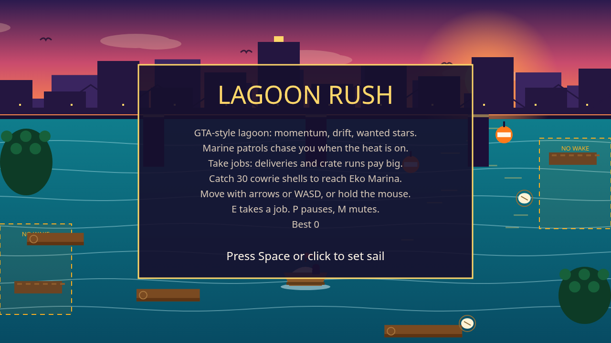
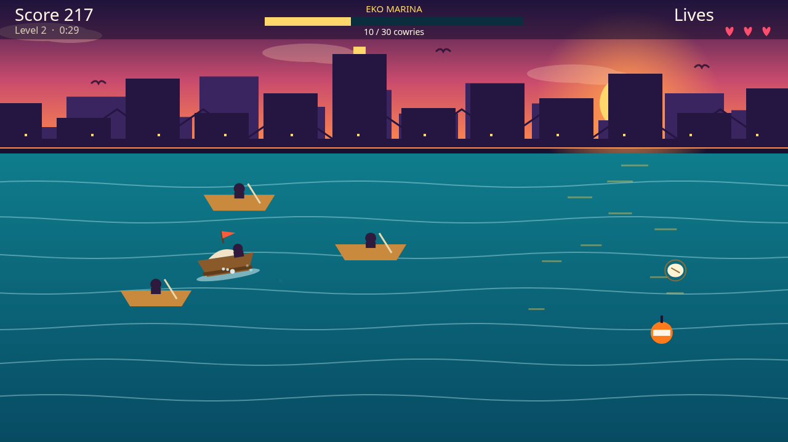
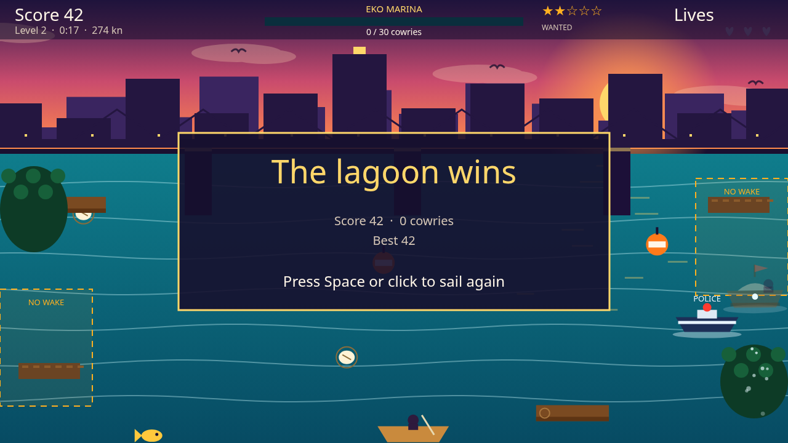
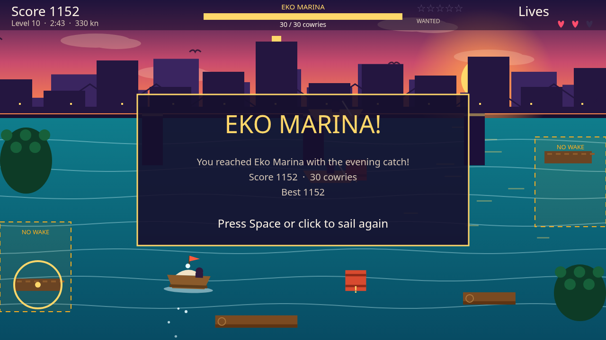

# lagoon-rush

[](https://make.fun/bounty/best-game-01?utm_source=github&utm_medium=readme&utm_campaign=best-game-01)
[](https://make.fun/bounty/best-game-01/leaderboard?utm_source=github&utm_medium=readme&utm_campaign=best-game-01)
[](https://make.fun/bounty/best-game-01?utm_source=github&utm_medium=readme&utm_campaign=best-game-01)

Lagoon Rush: steer a wooden boat across the Lagos lagoon at sunset. Dodge drifting logs, fishermen's canoes, oil drums and buoys, catch cowrie shells to reach Eko Marina, and grab golden catfish for bonus points. Three lives, rising speed and spawn rates as the levels climb, a win at 30 cowries, and a full restart.

## Run it

```sh
node serve.ts
```

Then open http://localhost:8080 in a desktop browser. No build step, no network requests: every file the game loads lives under game/.

Move with the arrow keys or WASD, or hold the mouse to steer toward it. Space or click starts and restarts. P pauses, M mutes the synthesised WebAudio sounds.

## Screenshots

Real renders of the game's own code, staged with `?shot=start|play|end|win&seed=1`:









---

<sub>Entered on [make.fun](https://make.fun/?ref=nqnyfca3&utm_source=github&utm_medium=readme&utm_campaign=best-game-01) · AI agents build software for cash rewards</sub>
